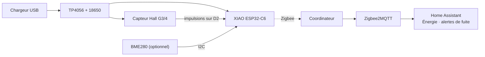

<div align="center">

# 💧 Water Flow Meter Zigbee

**Sachez où part votre eau.** Un débitmètre d'eau Zigbee qui continue de compter pendant les coupures de courant et renforce votre maillage.<br>
Seeed XIAO ESP32-C6 + un capteur de débit à effet Hall G3/4 + une 18650 de secours · prêt pour Zigbee2MQTT & Home Assistant.

[](https://github.com/mmornati/water-flow-meter-zigbee/actions/workflows/ci.yml)
[](https://mmornati.github.io/water-flow-meter-zigbee/?lang=fr)
[](https://github.com/mmornati/water-flow-meter-zigbee/releases)
[](LICENSE)
<br>
[](https://wiki.seeedstudio.com/xiao_esp32c6_getting_started/)
[](https://www.zigbee2mqtt.io/)
[](https://www.home-assistant.io/)

[**🌐 Site web**](https://mmornati.github.io/water-flow-meter-zigbee/?lang=fr) · [**⚡ Flasher depuis le navigateur**](https://mmornati.github.io/water-flow-meter-zigbee/?lang=fr#flash) · [**📖 Guide de montage**](docs/fr/01-hardware-and-wiring.md) · [**📦 Versions**](https://github.com/mmornati/water-flow-meter-zigbee/releases)

🌐 [English](README.md) · **Français** · [Italiano](README.it.md)

</div>

---

## ✨ Pourquoi celui-ci ?

La version Zigbee d'un compteur d'eau WiFi/ESPHome : même capteur, mêmes valeurs, sans WiFi.

|   |   |
|---|---|
| 💧 **Débit et total** | Débit en direct en L/min et un total en litres qui va directement dans le **tableau de bord Énergie** de Home Assistant |
| 🔋 **Résiste aux coupures de courant** | Alimenté en USB avec une 18650 de secours ; le total est enregistré en flash et survit aussi aux redémarrages |
| 🎯 **Comptage matériel des impulsions** | Le compteur PCNT de l'ESP32-C6 avec un filtre anti-parasites : aucune impulsion perdue pendant que la radio émet |
| 🪣 **Étalonnage depuis HA** | Le nombre d'impulsions par litre est stocké dans l'appareil ; un seau et deux scripts calculent la bonne valeur pour vous |
| 🚨 **Alertes de fuite** | Alertes de débit continu, de consommation nocturne, de compteur hors ligne et de passage sur batterie dans le package HA |
| 📡 **Aussi un routeur Zigbee** | Toujours alimenté, il relaie le trafic des appareils Zigbee autour de votre local technique |
| 🌡️ **BME280 en option** | Température, humidité et pression, détecté au démarrage |
| ⚡ **Flashage depuis le navigateur** | Aucune chaîne de compilation nécessaire : branchez l'USB et installez depuis le [site web](https://mmornati.github.io/water-flow-meter-zigbee/?lang=fr#flash) |
| ✅ **Testé à chaque commit** | Tests unitaires, deux compilations du firmware, tests du convertisseur avec la propre bibliothèque de Z2M, et le vérificateur de configuration de Home Assistant |

## 🚀 Démarrage rapide

1. **Câblez-le.** TP4056 `OUT` → `5V`/`GND` du XIAO et rouge/noir du capteur, jaune du capteur → diode → `D2`. [Guide de câblage →](docs/fr/01-hardware-and-wiring.md)
2. **Flashez-le.** Depuis le [site web](https://mmornati.github.io/water-flow-meter-zigbee/?lang=fr#flash) (Chrome ou Edge), ou compilez-le vous-même :

   ```bash
   cd firmware
   pio run -t erase && pio run -t upload
   ```

3. **Ajoutez le convertisseur.** Copiez [`zigbee2mqtt/water_flow_meter.mjs`](zigbee2mqtt/water_flow_meter.mjs) dans le dossier `external_converters/` de Zigbee2MQTT et redémarrez Z2M.
4. **Appairez-le.** *Permit join* (autoriser l'appairage) dans Z2M ; la LED clignote pendant la recherche et s'éteint une fois le réseau rejoint. Nommez-le `water_meter`.
5. **Home Assistant.** Copiez [`homeassistant/water_meter.yaml`](homeassistant/water_meter.yaml) dans `/config/packages/`, ajoutez le total au tableau de bord Énergie et [étalonnez](docs/fr/04-zigbee2mqtt-and-home-assistant.md#étalonnage).



## 🧰 Liste du matériel

| Composant | Rôle | Remarques |
|---|---|---|
| Seeed XIAO ESP32-C6 | Radio Zigbee + MCU | Le firmware bascule sur l'antenne externe |
| Antenne U.FL 2,4 GHz | Portée depuis un local technique | Recommandée |
| Capteur de débit Hall SWAWIS G3/4, 1–30 L/min | Le capteur | ~490 impulsions/L, étalonnez le vôtre |
| Module TP4056 USB-C **avec protection** | Charge + chemin d'alimentation | Version 6 broches (`B+`/`B-` et `OUT+`/`OUT-`) |
| Cellule 18650 (Panasonic NCR18650B) + support | Secours | Un à deux jours sans USB |
| Diode BAT85 / 1N5819 + 10 kΩ | Signal d'impulsion sûr en 3,3 V | [Pourquoi](docs/fr/01-hardware-and-wiring.md#le-signal-des-impulsions--à-lire-avant-de-câbler) |
| *Optionnel :* BME280 | Température, humidité, pression | |
| *Optionnel :* 2 × 100 kΩ + 100 nF | Tension de la batterie | Active l'alerte de passage sur batterie |

## 📖 Documentation

| | Guide | Contenu |
|---|---|---|
| 01 | [Matériel et câblage](docs/fr/01-hardware-and-wiring.md) | Chemin d'alimentation, le piège du signal 5 V, tableau des connexions, broches |
| 02 | [Montage pas à pas](docs/fr/02-build-guide.md) | Test sur l'établi, plomberie, boîtier, vérifications finales |
| 03 | [Firmware](docs/fr/03-firmware.md) | Compilation et flashage, endpoints, étalonnage, réglage du total, mesure de la batterie |
| 04 | [Zigbee2MQTT & Home Assistant](docs/fr/04-zigbee2mqtt-and-home-assistant.md) | Convertisseur, appairage, entités, tableau de bord Énergie, le package |
| 05 | [Dépannage](docs/fr/05-troubleshooting.md) | Symptômes, causes et solutions |

## 🤔 FAQ

<details>
<summary><b>Pourquoi Zigbee et pas ma version ESPHome/WiFi ?</b></summary>

Ni identifiants, ni adresse IP, ni clé d'API : il rejoint le maillage que vos autres capteurs utilisent et continue de fonctionner quand le WiFi tombe. Sur batterie, le Zigbee consomme aussi bien moins qu'une connexion WiFi.

| Ce que vous perdez (par rapport à WiFi + ESPHome) | Impact |
|---|---|
| Mises à jour OTA par WiFi | Mises à jour par USB. Rare une fois l'étalonnage fait |
| Interface web et logs réseau | Logs sur le moniteur série USB |
| Découverte sans configuration | Un convertisseur Z2M (fourni et testé) |

</details>

<details>
<summary><b>Perd-il de l'eau quand le réseau ou Home Assistant est en panne ?</b></summary>

Non. Le comptage est fait par le matériel et le total est conservé dans l'appareil. Quand le réseau revient, Home Assistant reçoit le nouveau total ; les statistiques `total_increasing` se rattrapent d'elles-mêmes.

</details>

<details>
<summary><b>Peut-il fonctionner uniquement sur batterie ?</b></summary>

Pas longtemps : le capteur Hall consomme 5–15 mA en permanence et un routeur ne dort jamais, donc une 18650 tient un à deux jours. La batterie sert de secours pendant les coupures de courant.

</details>

<details>
<summary><b>Mon historique va-t-il bouger si je refais l'étalonnage ?</b></summary>

Non. Un nouveau `pulses_per_liter` ne s'applique qu'à l'eau comptée à partir de ce moment.

</details>

## 🧪 Qualité

Chaque push et pull request lance la [CI](.github/workflows/ci.yml) :

| Vérification | Ce qu'elle prouve |
|---|---|
| **Tests unitaires** (`pio test -e native`) | Moyenne du débit, totaux exacts, étalonnage, cadence des rapports et des sauvegardes en flash, débordement de `millis()` |
| **Compilation PlatformIO** | Le firmware compile pour le XIAO ESP32-C6 en mode routeur Zigbee, avec et sans mesure de la batterie |
| **Compilation Arduino CLI** | Le même sketch fonctionne toujours pour les utilisateurs d'Arduino IDE |
| **Tests du convertisseur** | La propre bibliothèque `zigbee-herdsman-converters` de Z2M reconnaît l'appareil, décode chaque endpoint et écrit l'étalonnage et le total sur le bon ; le modèle et les endpoints correspondent au firmware |
| **Vérification Home Assistant** | Le package passe le `check_config` de Home Assistant |
| **Liens de la doc** | Aucun lien cassé entre les guides |

Taguez une version (`git tag v1.0.0 && git push --tags`) et le [workflow de release](.github/workflows/release.yml) publie les binaires du firmware avec leurs sommes de contrôle.

## 🗂️ Organisation du dépôt

```
firmware/
  platformio.ini                build settings (board, Zigbee router mode, tests)
  flow_meter/flow_meter.ino     the sketch
  flow_meter/flow_logic.h       flow, total, report and save logic (unit tested)
  test/                         host unit tests
zigbee2mqtt/
  water_flow_meter.mjs          Zigbee2MQTT external converter
  test/                         converter integration tests
homeassistant/
  water_meter.yaml              HA package: utility meters, leak alerts, calibration
  ci/                           Home Assistant config check
docs/                           build guides
```

## 📄 Licence

[MIT](LICENSE) © Marco Mornati. Sans lien avec Seeed Studio, Espressif, Zigbee2MQTT ou Home Assistant.
