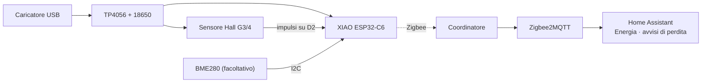

<div align="center">

# 💧 Water Flow Meter Zigbee

**Sai dove va a finire la tua acqua.** Un contatore d'acqua Zigbee che continua a contare anche durante i blackout e rinforza la tua mesh.<br>
Seeed XIAO ESP32-C6 + un sensore di flusso a effetto Hall G3/4 + un 18650 di backup · pronto per Zigbee2MQTT e Home Assistant.

[](https://github.com/mmornati/water-flow-meter-zigbee/actions/workflows/ci.yml)
[](https://mmornati.github.io/water-flow-meter-zigbee/?lang=it)
[](https://github.com/mmornati/water-flow-meter-zigbee/releases)
[](LICENSE)
<br>
[](https://wiki.seeedstudio.com/xiao_esp32c6_getting_started/)
[](https://www.zigbee2mqtt.io/)
[](https://www.home-assistant.io/)

[**🌐 Sito web**](https://mmornati.github.io/water-flow-meter-zigbee/?lang=it) · [**⚡ Flash dal browser**](https://mmornati.github.io/water-flow-meter-zigbee/?lang=it#flash) · [**📖 Guida alla costruzione**](docs/it/01-hardware-and-wiring.md) · [**📦 Release**](https://github.com/mmornati/water-flow-meter-zigbee/releases)

🌐 [English](README.md) · [Français](README.fr.md) · **Italiano**

</div>

---

## ✨ Perché proprio questo?

La versione Zigbee di un monitor dell'acqua WiFi/ESPHome: stesso sensore, stessi numeri, niente WiFi.

|   |   |
|---|---|
| 💧 **Flusso e totale** | Flusso in tempo reale in L/min e un totale in litri che finisce dritto nella **dashboard Energia** di Home Assistant |
| 🔋 **Resiste ai blackout** | Funziona via USB con un 18650 di backup; il totale è salvato in flash e sopravvive anche ai riavvii |
| 🎯 **Conteggio degli impulsi in hardware** | Il contatore PCNT dell'ESP32-C6 con filtro anti-glitch: nessun impulso perso mentre la radio trasmette |
| 🪣 **Calibrazione da HA** | Gli impulsi per litro sono salvati sul dispositivo; un secchio e due script calcolano il valore giusto al posto tuo |
| 🚨 **Avvisi di perdita** | Avvisi per flusso continuo, consumi notturni, dispositivo offline e funzionamento a batteria nel package di HA |
| 📡 **Anche un router Zigbee** | Sempre alimentato, quindi inoltra il traffico dei dispositivi Zigbee intorno al locale tecnico |
| 🌡️ **BME280 facoltativo** | Temperatura, umidità e pressione, rilevato all'avvio |
| ⚡ **Flash dal browser** | Non serve nessuna toolchain: collega l'USB e installa dal [sito web](https://mmornati.github.io/water-flow-meter-zigbee/?lang=it#flash) |
| ✅ **Testato a ogni commit** | Unit test, due build del firmware, test del converter con la libreria stessa di Z2M e il controllo di configurazione di Home Assistant |

## 🚀 Avvio rapido

1. **Collegalo.** `OUT` del TP4056 → `5V`/`GND` dello XIAO e rosso/nero del sensore, giallo del sensore → diodo → `D2`. [Guida ai collegamenti →](docs/it/01-hardware-and-wiring.md)
2. **Flashalo.** Dal [sito web](https://mmornati.github.io/water-flow-meter-zigbee/?lang=it#flash) (Chrome o Edge), oppure compilalo tu:

   ```bash
   cd firmware
   pio run -t erase && pio run -t upload
   ```

3. **Aggiungi il converter.** Copia [`zigbee2mqtt/water_flow_meter.mjs`](zigbee2mqtt/water_flow_meter.mjs) nella cartella `external_converters/` di Zigbee2MQTT e riavvia Z2M.
4. **Abbinalo.** *Permit join* (consenti l'accesso) in Z2M; il LED lampeggia mentre cerca la rete e si spegne una volta collegato. Chiamalo `water_meter`.
5. **Home Assistant.** Copia [`homeassistant/water_meter.yaml`](homeassistant/water_meter.yaml) in `/config/packages/`, aggiungi il totale alla dashboard Energia e [calibralo](docs/it/04-zigbee2mqtt-and-home-assistant.md#calibrazione).



## 🧰 Distinta dei componenti

| Componente | Ruolo | Note |
|---|---|---|
| Seeed XIAO ESP32-C6 | Radio Zigbee + MCU | Il firmware passa all'antenna esterna |
| Antenna U.FL 2,4 GHz | Portata anche da un locale tecnico | Consigliata |
| Sensore di flusso Hall SWAWIS G3/4, 1–30 L/min | Il sensore | ~490 impulsi/L, calibra il tuo |
| Modulo TP4056 USB-C **con protezione** | Ricarica + alimentazione | Versione a 6 pin (`B+`/`B-` e `OUT+`/`OUT-`) |
| Cella 18650 (Panasonic NCR18650B) + portabatteria | Backup | Da uno a due giorni senza USB |
| Diodo BAT85 / 1N5819 + 10 kΩ | Segnale degli impulsi sicuro a 3,3 V | [Perché](docs/it/01-hardware-and-wiring.md#il-segnale-degli-impulsi-leggi-qui-prima-di-collegare) |
| *Facoltativo:* BME280 | Temperatura, umidità, pressione | |
| *Facoltativo:* 2 × 100 kΩ + 100 nF | Tensione della batteria | Abilita l'avviso di funzionamento a batteria |

## 📖 Documentazione

| | Guida | Cosa trovi |
|---|---|---|
| 01 | [Hardware e collegamenti](docs/it/01-hardware-and-wiring.md) | Alimentazione, la trappola del segnale a 5 V, tabella dei collegamenti, pin |
| 02 | [Costruzione passo passo](docs/it/02-build-guide.md) | Test al banco, idraulica, contenitore, controlli finali |
| 03 | [Firmware](docs/it/03-firmware.md) | Compilazione e flash, endpoint, calibrazione, impostazione del totale, misura della batteria |
| 04 | [Zigbee2MQTT e Home Assistant](docs/it/04-zigbee2mqtt-and-home-assistant.md) | Converter, abbinamento, entità, dashboard Energia, il package |
| 05 | [Risoluzione dei problemi](docs/it/05-troubleshooting.md) | Sintomi, cause e soluzioni |

## 🤔 FAQ

<details>
<summary><b>Perché Zigbee e non la mia versione ESPHome/WiFi?</b></summary>

Niente credenziali, niente IP, niente API key: entra nella mesh che usano già i tuoi altri sensori e continua a funzionare quando il WiFi non va. A batteria, poi, lo Zigbee consuma molto meno di una connessione WiFi.

| A cosa rinunci (rispetto a WiFi + ESPHome) | Impatto |
|---|---|
| Aggiornamenti OTA via WiFi | Aggiornamenti via USB. Capita di rado una volta calibrato |
| Interfaccia web e log in rete | Log sul monitor seriale USB |
| Rilevamento senza configurazione | Un converter Z2M (incluso e testato) |

</details>

<details>
<summary><b>Perde il conteggio dell'acqua mentre la rete o Home Assistant non funzionano?</b></summary>

No. Il conteggio lo fa l'hardware e il totale resta sul dispositivo. Quando la rete torna, Home Assistant riceve il nuovo totale; le statistiche `total_increasing` si riallineano da sole.

</details>

<details>
<summary><b>Può funzionare solo a batteria?</b></summary>

Non a lungo: il sensore Hall assorbe 5–15 mA in continuazione e un router non dorme mai, quindi un 18650 dura da uno a due giorni. La batteria è un backup per i blackout.

</details>

<details>
<summary><b>Se ricalibro, lo storico cambia?</b></summary>

No. Un nuovo `pulses_per_liter` vale solo per l'acqua contata da quel momento in poi.

</details>

## 🧪 Qualità

Ogni push e pull request esegue la [CI](.github/workflows/ci.yml):

| Controllo | Cosa dimostra |
|---|---|
| **Unit test** (`pio test -e native`) | Media del flusso, totali esatti, calibrazione, tempistiche di invio e di salvataggio in flash, overflow di `millis()` |
| **Build PlatformIO** | Il firmware compila per lo XIAO ESP32-C6 in modalità router Zigbee, con e senza misura della batteria |
| **Build Arduino CLI** | Lo stesso sketch funziona ancora per chi usa Arduino IDE |
| **Test del converter** | La libreria `zigbee-herdsman-converters` di Z2M riconosce il dispositivo, decodifica ogni endpoint e scrive calibrazione/totale su quello giusto; modello ed endpoint corrispondono al firmware |
| **Controllo Home Assistant** | Il package supera il `check_config` di Home Assistant |
| **Link della documentazione** | Nessun link rotto tra le guide |

Crea un tag di versione (`git tag v1.0.0 && git push --tags`) e il [workflow di release](.github/workflows/release.yml) pubblica i binari del firmware con i checksum.

## 🗂️ Struttura del repository

```
firmware/
  platformio.ini                build settings (board, Zigbee router mode, tests)
  flow_meter/flow_meter.ino     the sketch
  flow_meter/flow_logic.h       flow, total, report and save logic (unit tested)
  test/                         host unit tests
zigbee2mqtt/
  water_flow_meter.mjs          Zigbee2MQTT external converter
  test/                         converter integration tests
homeassistant/
  water_meter.yaml              HA package: utility meters, leak alerts, calibration
  ci/                           Home Assistant config check
docs/                           build guides
```

## 📄 Licenza

[MIT](LICENSE) © Marco Mornati. Non affiliato a Seeed Studio, Espressif, Zigbee2MQTT o Home Assistant.
