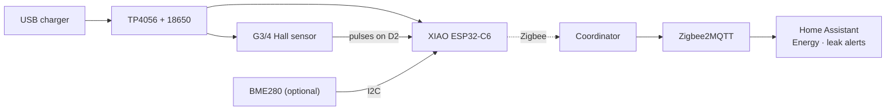

<div align="center">

# 💧 Water Flow Meter Zigbee

**Know where your water goes.** A Zigbee water flow meter that keeps counting through power cuts and strengthens your mesh.<br>
Seeed XIAO ESP32-C6 + a G3/4 Hall flow sensor + an 18650 backup · Zigbee2MQTT & Home Assistant ready.

[](https://github.com/mmornati/water-flow-meter-zigbee/actions/workflows/ci.yml)
[](https://mmornati.github.io/water-flow-meter-zigbee/)
[](https://github.com/mmornati/water-flow-meter-zigbee/releases)
[](LICENSE)
<br>
[](https://wiki.seeedstudio.com/xiao_esp32c6_getting_started/)
[](https://www.zigbee2mqtt.io/)
[](https://www.home-assistant.io/)

[**🌐 Website**](https://mmornati.github.io/water-flow-meter-zigbee/) · [**⚡ Flash in your browser**](https://mmornati.github.io/water-flow-meter-zigbee/#flash) · [**📖 Build guide**](docs/01-hardware-and-wiring.md) · [**📦 Releases**](https://github.com/mmornati/water-flow-meter-zigbee/releases)

🌐 **English** · [Français](README.fr.md) · [Italiano](README.it.md)

</div>

---

## ✨ Why this one?

The Zigbee version of a WiFi/ESPHome water monitor: same sensor, same numbers, no WiFi.

|   |   |
|---|---|
| 💧 **Flow and total** | Live flow in L/min and a total in litres that goes straight into Home Assistant's **Energy dashboard** |
| 🔋 **Survives power cuts** | Runs from USB with an 18650 backup; the total is stored in flash and survives reboots too |
| 🎯 **Hardware pulse counting** | The ESP32-C6 PCNT counter with a glitch filter: no pulse lost while the radio talks |
| 🪣 **Calibrate from HA** | Pulses per litre stored on the device; a bucket and two scripts compute the right value for you |
| 🚨 **Leak alerts** | Continuous flow, night usage, offline and on-battery alerts in the HA package |
| 📡 **A Zigbee router, too** | Always powered, so it relays traffic for the Zigbee devices around your utility room |
| 🌡️ **Optional BME280** | Temperature, humidity and pressure, detected at boot |
| ⚡ **Flash from the browser** | No toolchain needed: plug in USB and install from the [website](https://mmornati.github.io/water-flow-meter-zigbee/#flash) |
| ✅ **Tested on every commit** | Unit tests, two firmware builds, converter tests against Z2M's own library, Home Assistant's config checker |

## 🚀 Quick start

1. **Wire it.** TP4056 `OUT` → XIAO `5V`/`GND` and sensor red/black, sensor yellow → diode → `D2`. [Wiring guide →](docs/01-hardware-and-wiring.md)
2. **Flash it.** From the [website](https://mmornati.github.io/water-flow-meter-zigbee/#flash) (Chrome or Edge), or build it yourself:

   ```bash
   cd firmware
   pio run -t erase && pio run -t upload
   ```

3. **Add the converter.** Copy [`zigbee2mqtt/water_flow_meter.mjs`](zigbee2mqtt/water_flow_meter.mjs) to Zigbee2MQTT's `external_converters/` folder and restart Z2M.
4. **Pair it.** *Permit join* in Z2M; the LED blinks while searching and turns off once joined. Name it `water_meter`.
5. **Home Assistant.** Copy [`homeassistant/water_meter.yaml`](homeassistant/water_meter.yaml) to `/config/packages/`, add the total to the Energy dashboard and [calibrate](docs/04-zigbee2mqtt-and-home-assistant.md#calibration).



## 🧰 Bill of materials

| Part | Role | Notes |
|---|---|---|
| Seeed XIAO ESP32-C6 | Zigbee radio + MCU | The firmware switches to the external antenna |
| 2.4 GHz U.FL antenna | Range from a utility room | Recommended |
| SWAWIS G3/4 Hall flow sensor, 1–30 L/min | The sensor | ~490 pulses/L, calibrate yours |
| TP4056 USB-C module **with protection** | Charging + power path | 6-pin version (`B+`/`B-` and `OUT+`/`OUT-`) |
| 18650 cell (Panasonic NCR18650B) + holder | Backup | One to two days without USB |
| BAT85 / 1N5819 diode + 10 kΩ | 3.3 V safe pulse signal | [Why](docs/01-hardware-and-wiring.md#the-pulse-signal-read-this-before-wiring) |
| *Optional:* BME280 | Temperature, humidity, pressure | |
| *Optional:* 2 × 100 kΩ + 100 nF | Battery voltage | Enables the on-battery alert |

## 📖 Documentation

| | Guide | What's inside |
|---|---|---|
| 01 | [Hardware & wiring](docs/01-hardware-and-wiring.md) | Power path, the 5 V signal pitfall, connection table, pins |
| 02 | [Step-by-step build](docs/02-build-guide.md) | Bench test, plumbing, enclosure, final checks |
| 03 | [Firmware](docs/03-firmware.md) | Build and flash, endpoints, calibration, setting the total, battery sensing |
| 04 | [Zigbee2MQTT & Home Assistant](docs/04-zigbee2mqtt-and-home-assistant.md) | Converter, pairing, entities, Energy dashboard, the package |
| 05 | [Troubleshooting](docs/05-troubleshooting.md) | Symptoms, causes and fixes |

## 🤔 FAQ

<details>
<summary><b>Why Zigbee and not my ESPHome/WiFi version?</b></summary>

No credentials, no IP, no API key: it joins the mesh your other sensors use and keeps working when the WiFi doesn't. On battery, Zigbee also draws far less than a WiFi connection.

| You give up (vs WiFi + ESPHome) | Impact |
|---|---|
| OTA updates over WiFi | Updates over USB. Rare once calibrated |
| Web UI and network logs | Logs on the USB serial monitor |
| Zero-config discovery | A Z2M converter (included and tested) |

</details>

<details>
<summary><b>Does it lose water while the network or Home Assistant is down?</b></summary>

No. Counting is done by hardware and the total is kept on the device. When the network comes back, Home Assistant gets the new total; `total_increasing` statistics catch up on their own.

</details>

<details>
<summary><b>Can it run on the battery alone?</b></summary>

Not for long: the Hall sensor draws 5–15 mA all the time and a router never sleeps, so an 18650 lasts one to two days. The battery is a backup for power cuts.

</details>

<details>
<summary><b>Will my history move if I recalibrate?</b></summary>

No. A new `pulses_per_liter` applies only to the water counted from then on.

</details>

## 🧪 Quality

Every push and pull request runs [CI](.github/workflows/ci.yml):

| Check | What it proves |
|---|---|
| **Unit tests** (`pio test -e native`) | Flow averaging, exact totals, calibration, report and flash-save timing, `millis()` rollover |
| **PlatformIO build** | The firmware compiles for the XIAO ESP32-C6 in Zigbee router mode, with and without battery sensing |
| **Arduino CLI build** | The same sketch still works for Arduino IDE users |
| **Converter tests** | Z2M's own `zigbee-herdsman-converters` resolves the device, decodes every endpoint and writes calibration/total to the right one; model and endpoints match the firmware |
| **Home Assistant check** | The package passes Home Assistant's own `check_config` |
| **Docs links** | No broken links between guides |

Tag a version (`git tag v1.0.0 && git push --tags`) and the [release workflow](.github/workflows/release.yml) publishes firmware binaries with checksums.

## 🗂️ Repository layout

```
firmware/
  platformio.ini                build settings (board, Zigbee router mode, tests)
  flow_meter/flow_meter.ino     the sketch
  flow_meter/flow_logic.h       flow, total, report and save logic (unit tested)
  test/                         host unit tests
zigbee2mqtt/
  water_flow_meter.mjs          Zigbee2MQTT external converter
  test/                         converter integration tests
homeassistant/
  water_meter.yaml              HA package: utility meters, leak alerts, calibration
  ci/                           Home Assistant config check
docs/                           build guides
```

## 📄 License

[MIT](LICENSE) © Marco Mornati. Not affiliated with Seeed Studio, Espressif, Zigbee2MQTT or Home Assistant.
