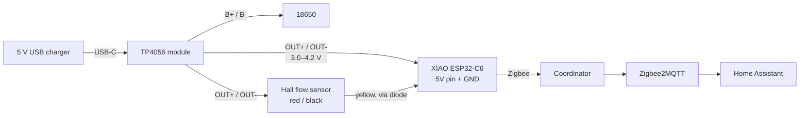

# 01 · Hardware & wiring

## Parts

| Part | Role | Notes |
|---|---|---|
| Seeed XIAO ESP32-C6 | Zigbee radio + MCU | Has a U.FL connector; the firmware switches to the external antenna |
| 2.4 GHz U.FL antenna | Range from inside a box or a utility room | Strongly recommended next to pipes and metal |
| G3/4 Hall flow sensor, 1–30 L/min (e.g. SWAWIS) | Counts the water | 3 wires: red = VCC, black = GND, yellow = pulse |
| TP4056 USB-C charger module, **with protection** (6 pins: `IN`, `B+`/`B-`, `OUT+`/`OUT-`) | Charges the 18650 and powers the board | The 4-pin version has no over-discharge protection: avoid it |
| 18650 cell (e.g. Panasonic NCR18650B) + holder with leads | Keeps counting during a power cut | |
| 5 V USB charger + USB-C cable | Main power | Any 1 A phone charger |
| Schottky diode (BAT85, 1N5819...) + 10 kΩ resistor | Safe signal level for the ESP32 | See [the signal](#the-pulse-signal-read-this-before-wiring) |
| *Optional:* BME280 breakout (I2C, 3.3 V) | Temperature, humidity, pressure | Address 0x76 or 0x77, both are tried |
| *Optional:* 2 × 100 kΩ + 100 nF | Battery voltage sensing | Lets Home Assistant tell you when USB power is lost |

## How it is powered



The TP4056 `OUT` pins are the battery voltage, not 5 V: about 4.2 V while the charger is plugged in, falling to ~3.3 V as the cell empties. That is fine for both loads:

- the XIAO's `5V` pin goes through its on-board 3.3 V regulator, which keeps working down to ~3.4 V;
- most G3/4 Hall sensors work from ~3.5 V. Check yours on the bench: if it only counts with a real 5 V supply, see [Troubleshooting](05-troubleshooting.md#no-pulses-at-all).

The sensor draws 5–15 mA all the time, and the board stays awake as a Zigbee router, so a full NCR18650B lasts **about one to two days** without USB. It is a backup for power cuts, not a battery-powered design.

## The pulse signal: read this before wiring

ESP32-C6 pins are **not 5 V tolerant** (3.6 V max). Many Hall sensors have an internal pull-up to their own VCC, so their yellow wire swings up to the supply voltage (4.2 V here, more on a 5 V supply).

Power the sensor and measure yellow → black with a multimeter, without water flowing:

| You read | What it is | Wiring |
|---|---|---|
| ~0 V or a floating value | Open collector, no pull-up | Yellow straight to `D2`, plus 10 kΩ from `D2` to `3V3` |
| ≤ 3.3 V | Already safe | Yellow straight to `D2` |
| > 3.3 V | Pull-up to VCC | **Use the diode** (below) |

The diode works for every case, so when in doubt use it:

```
                3V3
                 │
               10 kΩ
                 │
 yellow ──|◄──── D2 (GPIO2)
       BAT85
  (bar towards the sensor)
```

When the sensor pulls low, the diode conducts and `D2` reads ~0.3 V. When the sensor goes high, the diode blocks and the 10 kΩ pulls `D2` to 3.3 V, whatever the sensor's own voltage.

## Connection table

| From | To | Notes |
|---|---|---|
| TP4056 `B+` / `B-` | 18650 `+` / `-` | Mind the polarity: a reversed cell destroys the module |
| TP4056 `OUT+` | XIAO `5V` **and** sensor red | |
| TP4056 `OUT-` | XIAO `GND` **and** sensor black | |
| Sensor yellow | Diode → XIAO `D2` (GPIO2) | 10 kΩ from `D2` to `3V3` |
| BME280 `VIN` / `GND` | XIAO `3V3` / `GND` | Optional |
| BME280 `SDA` | XIAO `D7` (GPIO17) | Same pins as the ESPHome version |
| BME280 `SCL` | XIAO `D8` (GPIO19) | |
| 18650 `+` → 100 kΩ → `D0` (GPIO0) → 100 kΩ → `GND` | Battery sensing | Optional, 100 nF from `D0` to `GND`; then enable `BATTERY_ADC_PIN` ([firmware](03-firmware.md#battery-sensing)) |
| U.FL antenna | XIAO U.FL connector | |

Power the board **only** through the TP4056. The XIAO's `5V` pin is wired straight to its USB-C port: plugging a USB cable into the XIAO while the TP4056 feeds that pin would push 5 V into the module and the cell. To flash, **disconnect the TP4056 `OUT+` wire first** (a 2-pin JST plug makes this easy), then use the XIAO's USB-C.

## Pins used by the firmware

| Pin | Function |
|---|---|
| `D2` / GPIO2 | Pulse input (hardware PCNT counter, 10 µs glitch filter) |
| `D0` / GPIO0 | Battery voltage (optional) |
| `D7` / GPIO17, `D8` / GPIO19 | I2C for the BME280 (optional) |
| GPIO3, GPIO14 | RF switch: external U.FL antenna |
| GPIO15 | User LED (blinks while not joined) |
| GPIO9 | BOOT button: hold 3 s to leave the network |

Next: [Step-by-step build](02-build-guide.md).
