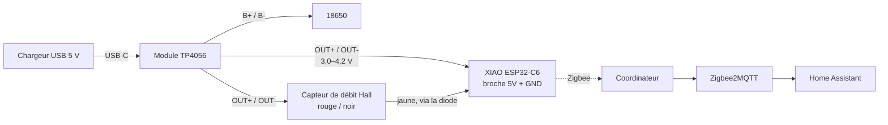

# 01 · Matériel et câblage

🌐 [English](../01-hardware-and-wiring.md) · **Français** · [Italiano](../it/01-hardware-and-wiring.md)

## Composants

| Composant | Rôle | Remarques |
|---|---|---|
| Seeed XIAO ESP32-C6 | Radio Zigbee + MCU | Dispose d'un connecteur U.FL ; le firmware bascule sur l'antenne externe |
| Antenne U.FL 2,4 GHz | Portée depuis l'intérieur d'un boîtier ou d'un local technique | Vivement recommandée à côté des tuyaux et du métal |
| Capteur de débit Hall G3/4, 1–30 L/min (par ex. SWAWIS) | Compte l'eau | 3 fils : rouge = VCC, noir = GND, jaune = impulsion |
| Module chargeur TP4056 USB-C, **avec protection** (6 broches : `IN`, `B+`/`B-`, `OUT+`/`OUT-`) | Charge la 18650 et alimente la carte | La version 4 broches n'a pas de protection contre la décharge profonde : évitez-la |
| Cellule 18650 (par ex. Panasonic NCR18650B) + support avec fils | Continue de compter pendant une coupure de courant | |
| Chargeur USB 5 V + câble USB-C | Alimentation principale | N'importe quel chargeur de téléphone 1 A |
| Diode Schottky (BAT85, 1N5819...) + résistance 10 kΩ | Niveau de signal sûr pour l'ESP32 | Voir [le signal](#le-signal-des-impulsions--à-lire-avant-de-câbler) |
| *Optionnel :* module BME280 (I2C, 3,3 V) | Température, humidité, pression | Adresse 0x76 ou 0x77, les deux sont essayées |
| *Optionnel :* 2 × 100 kΩ + 100 nF | Mesure de la tension de la batterie | Permet à Home Assistant de vous prévenir quand l'alimentation USB est coupée |

## Comment il est alimenté



Les broches `OUT` du TP4056 sortent la tension de la batterie, pas du 5 V : environ 4,2 V quand le chargeur est branché, qui descend vers ~3,3 V à mesure que la cellule se vide. Ça convient aux deux charges :

- la broche `5V` du XIAO passe par son régulateur 3,3 V intégré, qui fonctionne encore jusqu'à ~3,4 V ;
- la plupart des capteurs Hall G3/4 fonctionnent à partir de ~3,5 V. Vérifiez le vôtre sur l'établi : s'il ne compte qu'avec une vraie alimentation 5 V, voir [Dépannage](05-troubleshooting.md#aucune-impulsion).

Le capteur consomme 5–15 mA en permanence et la carte reste éveillée en tant que routeur Zigbee : une NCR18650B pleine tient donc **environ un à deux jours** sans USB. C'est un secours pour les coupures de courant, pas un montage conçu pour fonctionner sur batterie.

## Le signal des impulsions : à lire avant de câbler

Les broches de l'ESP32-C6 ne sont **pas tolérantes au 5 V** (3,6 V max). Beaucoup de capteurs Hall ont un pull-up interne vers leur propre VCC : leur fil jaune monte donc jusqu'à la tension d'alimentation (4,2 V ici, davantage avec une alimentation 5 V).

Alimentez le capteur et mesurez jaune → noir au multimètre, sans que l'eau ne coule :

| Vous lisez | Ce que c'est | Câblage |
|---|---|---|
| ~0 V ou une valeur flottante | Collecteur ouvert, sans pull-up | Jaune directement sur `D2`, plus 10 kΩ entre `D2` et `3V3` |
| ≤ 3,3 V | Déjà sûr | Jaune directement sur `D2` |
| > 3,3 V | Pull-up vers VCC | **Utilisez la diode** (ci-dessous) |

La diode fonctionne dans tous les cas : dans le doute, utilisez-la.

```
                3V3
                 │
               10 kΩ
                 │
  jaune ──|◄──── D2 (GPIO2)
       BAT85
  (barre côté capteur)
```

Quand le capteur tire vers le bas, la diode conduit et `D2` lit ~0,3 V. Quand le capteur passe à l'état haut, la diode bloque et la 10 kΩ tire `D2` à 3,3 V, quelle que soit la tension propre du capteur.

## Tableau des connexions

| De | Vers | Remarques |
|---|---|---|
| TP4056 `B+` / `B-` | 18650 `+` / `-` | Attention à la polarité : une cellule inversée détruit le module |
| TP4056 `OUT+` | XIAO `5V` **et** rouge du capteur | |
| TP4056 `OUT-` | XIAO `GND` **et** noir du capteur | |
| Jaune du capteur | Diode → XIAO `D2` (GPIO2) | 10 kΩ entre `D2` et `3V3` |
| BME280 `VIN` / `GND` | XIAO `3V3` / `GND` | Optionnel |
| BME280 `SDA` | XIAO `D7` (GPIO17) | Mêmes broches que la version ESPHome |
| BME280 `SCL` | XIAO `D8` (GPIO19) | |
| 18650 `+` → 100 kΩ → `D0` (GPIO0) → 100 kΩ → `GND` | Mesure de la batterie | Optionnel, 100 nF entre `D0` et `GND` ; activez ensuite `BATTERY_ADC_PIN` ([firmware](03-firmware.md#mesure-de-la-batterie)) |
| Antenne U.FL | Connecteur U.FL du XIAO | |

Alimentez la carte **uniquement** par le TP4056. La broche `5V` du XIAO est reliée directement à son port USB-C : brancher un câble USB sur le XIAO pendant que le TP4056 alimente cette broche enverrait du 5 V dans le module et la cellule. Pour flasher, **débranchez d'abord le fil `OUT+` du TP4056** (une prise JST 2 broches rend ça facile), puis utilisez l'USB-C du XIAO.

## Broches utilisées par le firmware

| Broche | Fonction |
|---|---|
| `D2` / GPIO2 | Entrée des impulsions (compteur matériel PCNT, filtre anti-parasites de 10 µs) |
| `D0` / GPIO0 | Tension de la batterie (optionnel) |
| `D7` / GPIO17, `D8` / GPIO19 | I2C pour le BME280 (optionnel) |
| GPIO3, GPIO14 | Commutateur RF : antenne externe U.FL |
| GPIO15 | LED utilisateur (clignote tant que le réseau n'est pas rejoint) |
| GPIO9 | Bouton BOOT : maintenez-le 3 s pour quitter le réseau |

Suite : [Montage pas à pas](02-build-guide.md).
