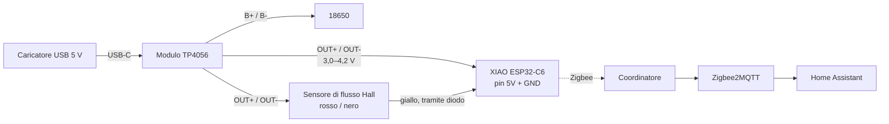

# 01 · Hardware e collegamenti

🌐 [English](../01-hardware-and-wiring.md) · [Français](../fr/01-hardware-and-wiring.md) · **Italiano**

## Componenti

| Componente | Ruolo | Note |
|---|---|---|
| Seeed XIAO ESP32-C6 | Radio Zigbee + MCU | Ha un connettore U.FL; il firmware passa all'antenna esterna |
| Antenna U.FL 2,4 GHz | Portata anche da dentro una scatola o un locale tecnico | Fortemente consigliata vicino a tubi e metallo |
| Sensore di flusso Hall G3/4, 1–30 L/min (es. SWAWIS) | Conta l'acqua | 3 fili: rosso = VCC, nero = GND, giallo = impulsi |
| Modulo di ricarica TP4056 USB-C, **con protezione** (6 pin: `IN`, `B+`/`B-`, `OUT+`/`OUT-`) | Ricarica il 18650 e alimenta la scheda | La versione a 4 pin non ha la protezione contro la scarica eccessiva: evitala |
| Cella 18650 (es. Panasonic NCR18650B) + portabatteria con fili | Continua a contare durante un blackout | |
| Caricatore USB 5 V + cavo USB-C | Alimentazione principale | Va bene qualsiasi caricatore da telefono da 1 A |
| Diodo Schottky (BAT85, 1N5819...) + resistenza da 10 kΩ | Livello del segnale sicuro per l'ESP32 | Vedi [il segnale](#il-segnale-degli-impulsi-leggi-qui-prima-di-collegare) |
| *Facoltativo:* breakout BME280 (I2C, 3,3 V) | Temperatura, umidità, pressione | Indirizzo 0x76 o 0x77, vengono provati entrambi |
| *Facoltativo:* 2 × 100 kΩ + 100 nF | Misura della tensione della batteria | Permette a Home Assistant di avvisarti quando manca l'alimentazione USB |

## Come viene alimentato



I pin `OUT` del TP4056 portano la tensione della batteria, non 5 V: circa 4,2 V con il caricatore collegato, che scendono a ~3,3 V man mano che la cella si scarica. Va bene per entrambi i carichi:

- il pin `5V` dello XIAO passa per il suo regolatore 3,3 V integrato, che continua a funzionare fino a ~3,4 V;
- la maggior parte dei sensori Hall G3/4 funziona da ~3,5 V. Prova il tuo al banco: se conta solo con una vera alimentazione a 5 V, vedi [Risoluzione dei problemi](05-troubleshooting.md#nessun-impulso).

Il sensore assorbe 5–15 mA in continuazione e la scheda resta sveglia come router Zigbee, quindi un NCR18650B carico dura **circa da uno a due giorni** senza USB. È un backup per i blackout, non un progetto pensato per funzionare a batteria.

## Il segnale degli impulsi: leggi qui prima di collegare

I pin dell'ESP32-C6 **non tollerano i 5 V** (3,6 V al massimo). Molti sensori Hall hanno un pull-up interno verso il proprio VCC, quindi il filo giallo sale fino alla tensione di alimentazione (qui 4,2 V, di più con un'alimentazione a 5 V).

Alimenta il sensore e misura giallo → nero con un multimetro, senza acqua che scorre:

| Leggi | Cos'è | Collegamento |
|---|---|---|
| ~0 V o un valore che fluttua | Open collector, senza pull-up | Giallo direttamente su `D2`, più 10 kΩ da `D2` a `3V3` |
| ≤ 3,3 V | Già sicuro | Giallo direttamente su `D2` |
| > 3,3 V | Pull-up verso VCC | **Usa il diodo** (qui sotto) |

Il diodo funziona in tutti i casi, quindi nel dubbio usalo:

```
                3V3
                 │
               10 kΩ
                 │
 yellow ──|◄──── D2 (GPIO2)
       BAT85
  (bar towards the sensor)
```

Quando il sensore tira verso il basso, il diodo conduce e `D2` legge ~0,3 V. Quando il sensore va alto, il diodo blocca e la 10 kΩ porta `D2` a 3,3 V, qualunque sia la tensione del sensore.

## Tabella dei collegamenti

| Da | A | Note |
|---|---|---|
| TP4056 `B+` / `B-` | 18650 `+` / `-` | Attenzione alla polarità: una cella al contrario distrugge il modulo |
| TP4056 `OUT+` | XIAO `5V` **e** rosso del sensore | |
| TP4056 `OUT-` | XIAO `GND` **e** nero del sensore | |
| Giallo del sensore | Diodo → XIAO `D2` (GPIO2) | 10 kΩ da `D2` a `3V3` |
| BME280 `VIN` / `GND` | XIAO `3V3` / `GND` | Facoltativo |
| BME280 `SDA` | XIAO `D7` (GPIO17) | Stessi pin della versione ESPHome |
| BME280 `SCL` | XIAO `D8` (GPIO19) | |
| 18650 `+` → 100 kΩ → `D0` (GPIO0) → 100 kΩ → `GND` | Misura della batteria | Facoltativa, 100 nF da `D0` a `GND`; poi abilita `BATTERY_ADC_PIN` ([firmware](03-firmware.md#misura-della-batteria)) |
| Antenna U.FL | Connettore U.FL dello XIAO | |

Alimenta la scheda **solo** tramite il TP4056. Il pin `5V` dello XIAO è collegato direttamente alla sua porta USB-C: se colleghi un cavo USB allo XIAO mentre il TP4056 alimenta quel pin, mandi 5 V nel modulo e nella cella. Per flashare, **scollega prima il filo `OUT+` del TP4056** (con un connettore JST a 2 pin è facile), poi usa l'USB-C dello XIAO.

## Pin usati dal firmware

| Pin | Funzione |
|---|---|
| `D2` / GPIO2 | Ingresso impulsi (contatore hardware PCNT, filtro anti-glitch da 10 µs) |
| `D0` / GPIO0 | Tensione della batteria (facoltativa) |
| `D7` / GPIO17, `D8` / GPIO19 | I2C per il BME280 (facoltativo) |
| GPIO3, GPIO14 | Switch RF: antenna esterna U.FL |
| GPIO15 | LED utente (lampeggia finché non è collegato) |
| GPIO9 | Pulsante BOOT: tienilo premuto 3 s per lasciare la rete |

Prossima guida: [Costruzione passo passo](02-build-guide.md).
